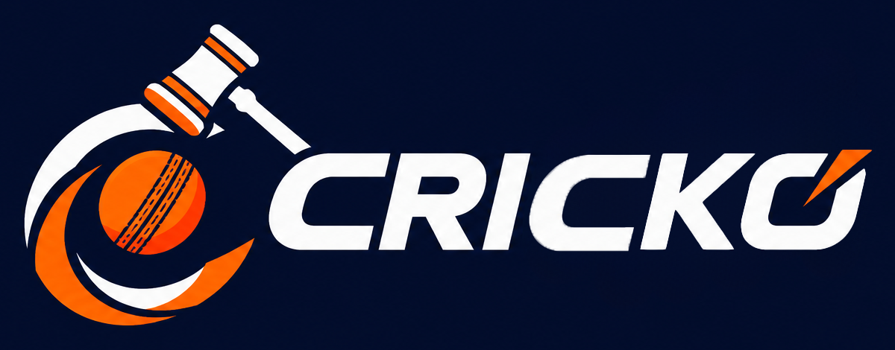

<div align="center">



# CRICKO — IPL Auction Bot

**A Discord-based IPL cricket auction simulation built with Python.**

Manage teams, bid for players, track team purses, and build your squad through an interactive auction experience.

<p>
  
  
  
</p>

</div>

---

## 📌 About the Project

**CRICKO** is an interactive IPL-style player auction bot for Discord. Participants register an IPL team, choose a player set, place bids, and monitor their team’s remaining purse and squad.

The project is designed to demonstrate Python programming, asynchronous bot interactions, and the flow of a simulated cricket auction.

## ✨ Features

- **Team registration** — choose from ten IPL team records.
- **Player-set auctions** — select from player groups such as marquee players, batters, all-rounders, wicket-keepers, fast bowlers, and spinners.
- **Interactive bidding** — place bids through Discord UI buttons.
- **Auction timer** — a countdown keeps the auction moving.
- **Purse tracking** — view your remaining team budget.
- **Squad overview** — review retained and purchased players.
- **Team overview** — inspect registered teams, their purses, and their squads.
- **RTM option** — the interface includes a Right to Match (RTM) control for eligible previous-team matches.
- **Auction results** — players are marked sold or unsold as the auction progresses.

## 🧰 Tech Stack

- Python
- `discord.py`
- `asyncio`
- `random`

## 📁 Project Structure

```text
CRICKO/
├── README.md
├── cricko-logo.png
├── auction.py
└── requirements.txt   # optional; create this if you use a dependency file
```

> Keep `cricko-logo.png` in the same directory as this README, or update the image path above to match your repository.

## ⚙️ Setup

### 1. Requirements

- Python 3.10 or a compatible version
- A Discord account and a Discord server where you have permission to add a bot
- A Discord application and bot created in the [Discord Developer Portal](https://discord.com/developers/applications)

### 2. Clone the repository

Replace `YOUR-USERNAME` and `YOUR-REPOSITORY` with your GitHub details.

```bash
git clone https://github.com/YOUR-USERNAME/YOUR-REPOSITORY.git
cd YOUR-REPOSITORY
```

### 3. Install dependencies

```bash
python -m pip install -U discord.py
```

If your project uses a `requirements.txt`, install from it instead:

```bash
python -m pip install -r requirements.txt
```

### 4. Configure the Discord bot

1. Create a bot application in the Discord Developer Portal.
2. Enable **Message Content Intent** if your code uses `intents.message_content = True`.
3. Invite the bot to your server with the permissions it needs to read messages and send messages.
4. Store the bot token in an environment variable. **Never commit the token to GitHub.**

For example, set an environment variable named `DISCORD_BOT_TOKEN`, then update the end of `auction.py` to use it:

```python
import os

bot.run(os.environ["DISCORD_BOT_TOKEN"])
```

On Windows PowerShell, set it for the current terminal session with:

```powershell
$env:DISCORD_BOT_TOKEN="paste-your-new-token-here"
python auction.py
```

On macOS or Linux:

```bash
export DISCORD_BOT_TOKEN="paste-your-new-token-here"
python auction.py
```

**Security note:** If a real Discord bot token has ever been included in a source file, PDF, screenshot, or public repository, reset it in the Discord Developer Portal before using the bot again.

## 🚀 Running the Bot

From the directory containing `auction.py`, run:

```bash
python auction.py
```

Once the bot is online, use the commands configured in the source code. The current code sets the command prefix to `cc `.

| Command | Purpose |
|---|---|
| `cc register_team` | Open the team registration selection |
| `cc start_auction` | Start the auction flow |
| `cc showplayers` | Show your registered team’s squad and purse |
| `cc purse` | Display your remaining purse |
| `cc show_teams` | Show registered teams, purses, and squads |

The command names above follow the names defined in the supplied Python source. If you rename commands or change the prefix, update this table to match.

## 🏏 Typical Auction Flow

1. Register a team.
2. Start the auction.
3. Choose a player set.
4. Review the player details and base price.
5. Place bids using the auction controls.
6. Check your purse and squad as the auction progresses.
7. Review sold and unsold player results.

## 🧪 Testing Checklist

- [ ] The bot starts and connects to Discord.
- [ ] A participant can register a team.
- [ ] The player-set selection flow responds correctly.
- [ ] Eligible participants can place bids.
- [ ] The timer and current bid display update correctly.
- [ ] Purse and squad displays show the expected information.
- [ ] Sold and unsold outcomes are handled correctly.

## ⚠️ Notes & Limitations

- This is an **auction simulation**, not an official IPL auction system.
- Player data, team purse values, retained-player lists, and image links are defined in the source and may need updating.
- Some sample player-image URLs in the supplied data may be placeholders and may not load.
- Test the bot in a private development server before using it with a larger group.
- Review auction-state handling and command permissions before deploying it for simultaneous users.

## 🔮 Possible Improvements

- Store teams, bids, and results persistently in a database.
- Add auction history and downloadable results.
- Improve validation for team registration and bid increments.
- Add admin controls for starting, pausing, and ending auctions.
- Add automated tests for purse calculations and auction outcomes.
- Improve player-data accuracy and image-link validation.

## 🤝 Contributing

Contributions and suggestions are welcome.

1. Fork the repository.
2. Create a feature branch.
3. Make and test your changes.
4. Open a pull request describing the update.

## 📄 License

No license has been specified yet. Add a `LICENSE` file before inviting others to reuse, modify, or distribute this project.

---

<div align="center">

**CRICKO — Build your squad. Make your bid. Own the auction.**

</div>

